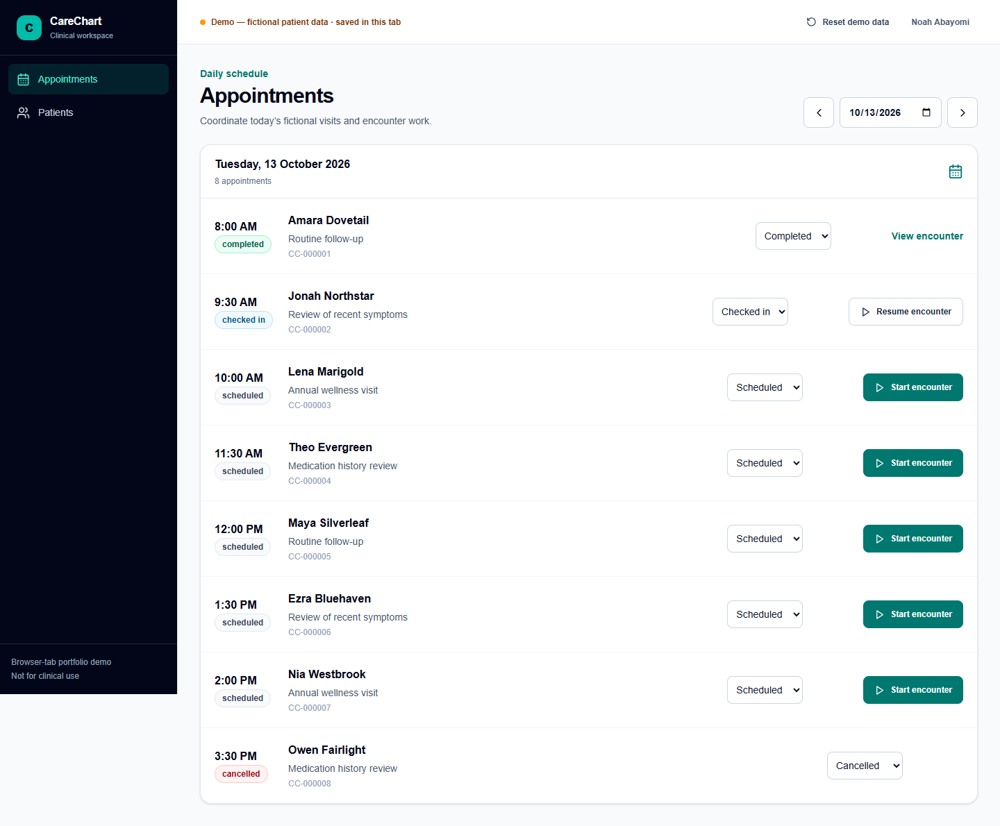
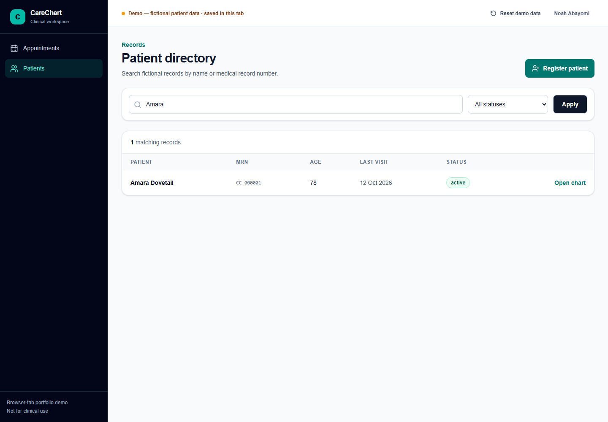
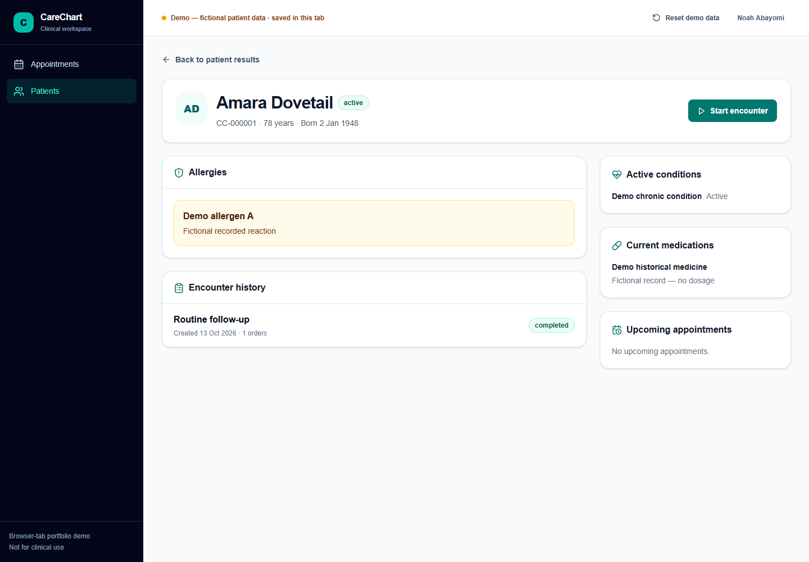
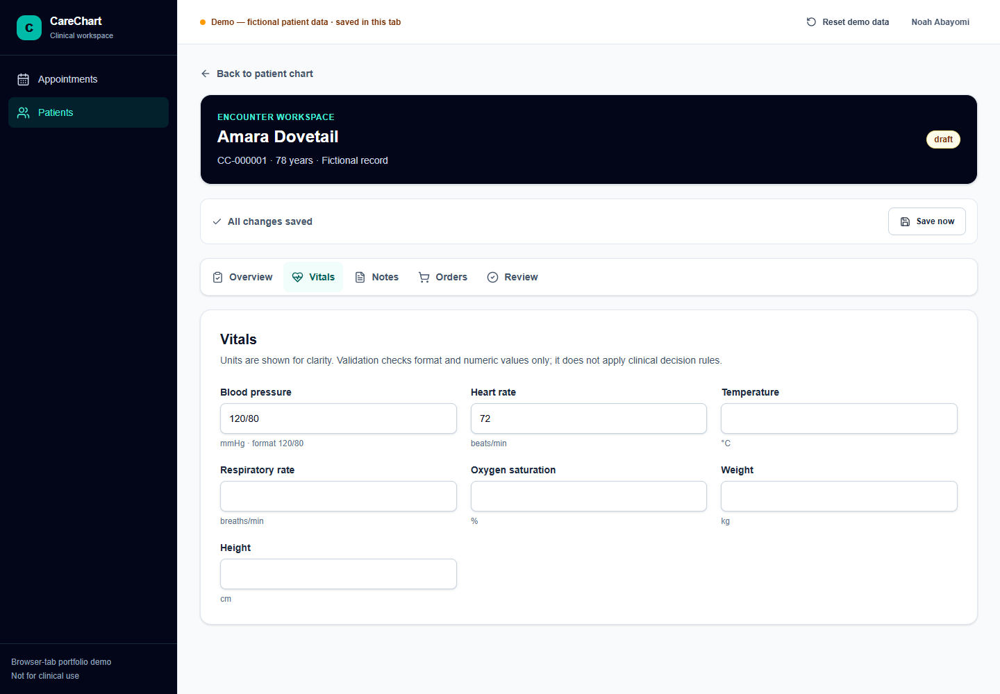
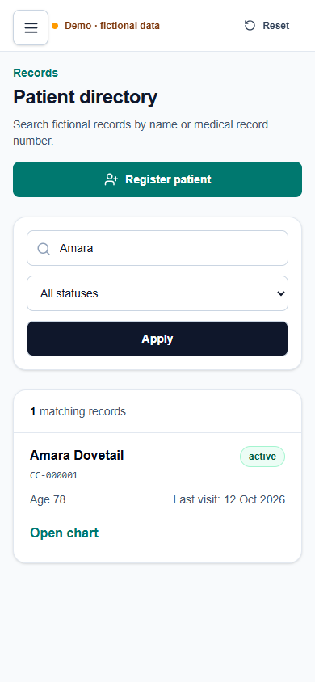

# CareChart

CareChart is a responsive, fictional Electronic Medical Record workflow portfolio by [Noah Abayomi](https://github.com/Pinnacle96). It demonstrates patient search and registration, charts, a daily appointment schedule, and a complete encounter flow: start a draft, record vitals and notes, add fictional orders, review, and complete.

> **Portfolio demo only.** Use fictional information. CareChart is not a clinical product, does not recommend diagnoses or dosages, and never transmits orders or prescriptions.

**Live demo:** _Add the Netlify URL after deployment._

## Why this can run publicly without a database

The site is a static Next.js export. It has no deployed API, database, login, or shared mutable server state. On first visit, it creates 30 fictional records in that browser tab's `sessionStorage`. Edits, new patients, drafts, appointment statuses, and reset all stay in that tab. Separate visitors do not share records or reset each other's work.

**Important trade-off:** Drafts survive refresh in the same tab, but they are not synced across devices or tabs. Closing the tab, clearing site storage, or a browser storage policy may remove them. Browser storage can be inspected or changed by its owner, so this is not secure medical-record storage. Do not enter real patient data.

## Screenshots











## Run locally

Requirements: Node.js 22+ and npm 10+.

```bash
npm ci
npm run dev
```

Open [http://localhost:3000](http://localhost:3000). No `.env` file or database setup is needed. To inspect the exact static output that Netlify serves:

```bash
npm run build
npm run preview
```

The static preview runs at [http://127.0.0.1:3100](http://127.0.0.1:3100).

## Deploy on Netlify

1. Import [Pinnacle96/carechart-emr-nextjs](https://github.com/Pinnacle96/carechart-emr-nextjs) from GitHub into Netlify and select the `main` branch.
2. Let the committed `netlify.toml` supply the build command (`npm run build`) and publish directory (`out`). `.nvmrc` pins Node.js 22. No database, Netlify Functions, or custom environment variables are required.
3. Deploy. Open the published site in two independent browser sessions to confirm they start with separate fictional data.
4. Add the resulting Netlify URL to the **Live demo** line above if desired.

Do not set the publish directory to `.next`: this release uses `output: "export"`, which creates `out/`.

## Checks

```bash
npm run lint
npm run typecheck
npm test
npm run test:e2e
```

`test:e2e` builds the static export and exercises it with Playwright. It checks desktop and mobile workflows, refresh recovery, save failure and retry, completion and read-only state, reset, and isolation between browser contexts. An installed Chrome browser is used locally; CI installs Playwright Chromium.

## Architecture

- `src/app` — static App Router pages and shared layout
- `src/features` — patient, appointment, and encounter UI
- `src/lib/browser-demo.ts` — tab-local seed, persistence, revision checks, and mutations
- `src/lib/patient-directory.ts` — search, filtering, and pagination
- `src/lib/validation` — Zod schemas and completion policy
- `tests` — validation, browser-store rules, and Playwright workflows
- `docs/technical-decisions.md` — design and persistence decisions
- `netlify.toml` — static Netlify build and publish settings

The encounter uses one React Hook Form instance across tabs. Saves are serialized and carry a revision plus a local edit sequence, so an older save result cannot mark newer edits as saved. On storage errors the form retains unsaved values and offers retry. Stale revision conflicts require an explicit choice. Completion requires a visit reason, subjective, assessment, and plan; this is a demo workflow policy, not a clinical standard. Completing makes the encounter read-only, marks its fictional orders ordered, and completes any linked appointment.

## Accessibility and limits

The UI includes semantic landmarks and labels, visible focus, accessible tabs and confirmation dialogs, status text in addition to colour, touch-sized actions, mobile navigation/cards, and reduced-motion support. No formal WCAG compliance claim is made without an independent audit.

This intentionally has no account system, cross-device persistence, shared team records, audit trail, or real-data security. Those would require a backend and durable storage; the browser-only demo should not be extended to real clinical use by simply adding a login screen.
